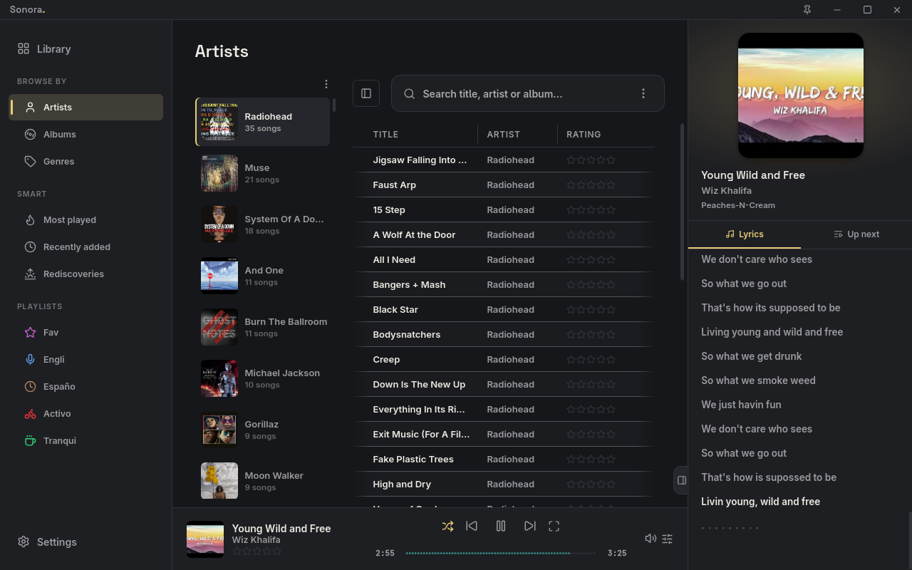
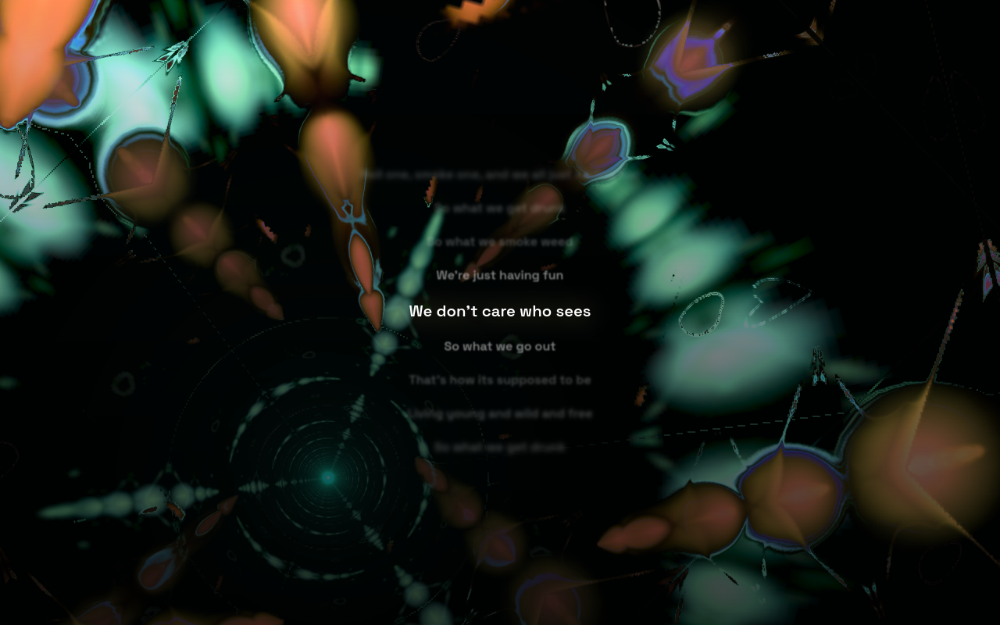
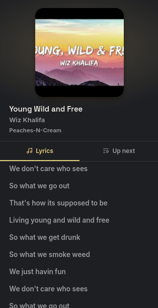
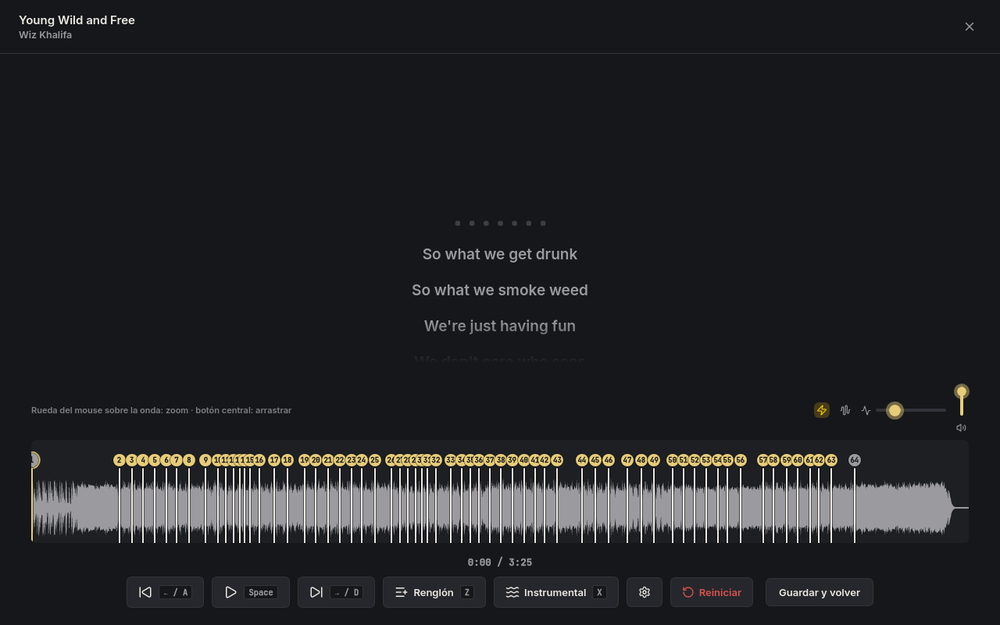
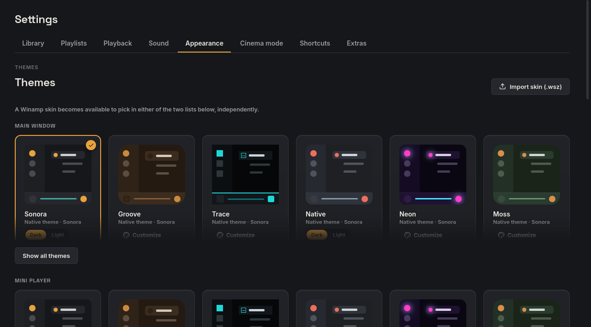
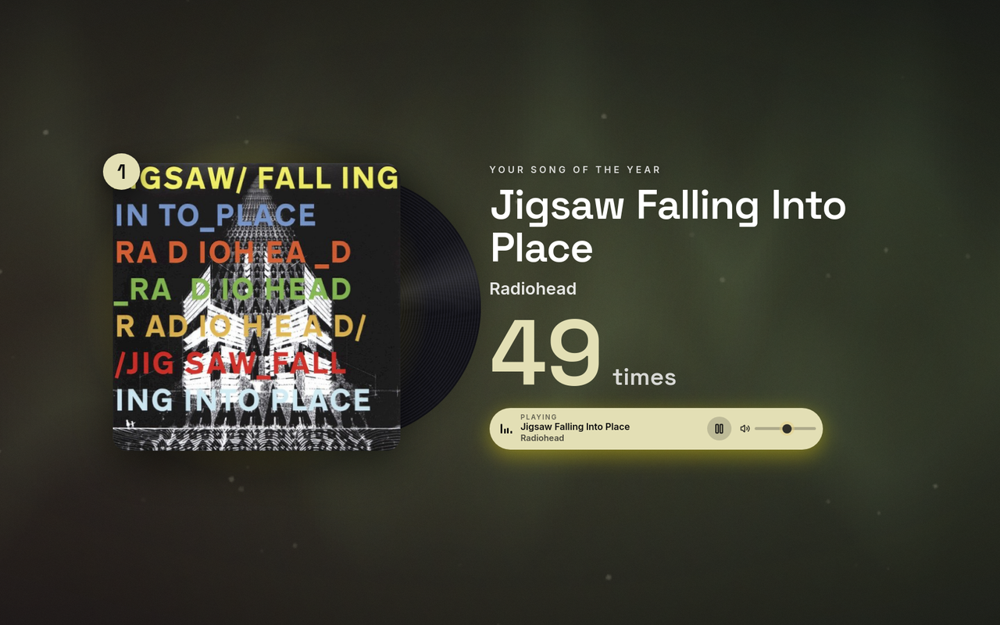

  

<h1 align="center">Sonora</h1>

  A music player for the songs you own, with synced lyrics, a cinema mode and a look you can make entirely your own.

  
  

  

## What it is

Point Sonora at your music folder and it builds your library by itself: artists, albums, genres and covers. It's fast, needs no account and works offline. It's made for people who keep their music as files and want to enjoy it properly.

On the first run a short setup walks you through your music folders, the look, where playlists live and how lyrics are found, in about a minute.

<table>
  <tr>
    <td width="62%"></td>
    <td width="38%">
      <h3>Cinema mode</h3>
      
Turn the whole screen into a light show. Hundreds of MilkDrop visualizations react to the music, with the lyrics floating on top.

      
It can change the visualization with every song or every few seconds, and you can keep your favorites and hide the ones you don't like.

    </td>
  </tr>
  <tr>
    <td width="62%">
      <h3>Lyrics that follow the song</h3>
      
Sonora shows synced lyrics line by line, from <code>.lrc</code> files next to your songs, from the tags inside them, or by looking them up for you as <i>artist - title</i> (LRCLIB and NetEase). Lookups are optional and can be turned off.

      
Lyrics that only exist as plain text are spread over the song automatically, so they still scroll along.

    </td>
    <td width="38%" align="center"></td>
  </tr>
  <tr>
    <td width="62%"></td>
    <td width="38%">
      <h3>Sync them yourself</h3>
      
No synced lyrics for a song? Play it and tap a key on every line, with the waveform to guide you. Zoom into the waveform, drag the markers to fine-tune them and mark instrumental parts.

    </td>
  </tr>
  <tr>
    <td width="62%">
      <h3>Make it look like yours</h3>
      
Pick a theme for the main window and another for the mini player, light or dark, and customize its colors.

      
Change fonts, spacing, corners, the seek bar and which buttons show up. Scale the whole interface from 100% to 150%. Or load a classic Winamp skin (<code>.wsz</code>).

    </td>
    <td width="38%"></td>
  </tr>
  <tr>
    <td width="62%"></td>
    <td width="38%">
      <h3>Your year in music</h3>
      
<b>Unwrapped</b> turns what you played into a full-screen story: minutes listened, your song, artist and genre of the year, your best days and streaks. Songs play as you tap through it, and you can pick a color palette.

      
Everything is computed on your computer, and you can export it as an image, PDF or data file.

    </td>
  </tr>
</table>

## Features

- **Smart playlists** that fill themselves from rules, plus ready-made lists for your most played songs, recent additions and songs you haven't heard in a while.
- **Smart shuffle** that favors songs you rate higher or play less, and avoids playing the same artist twice in a row.
- **An animated, comfortable interface** with smooth transitions, ratings and columns you can arrange the way you like.
- **Fast**, even with thousands of songs. The library updates itself when you add or remove music.
- **Great sound**: an equalizer with profiles for your headphone model, volume normalization and crossfade between songs. On Windows it can also send audio straight to your sound card, untouched (bit-perfect).
- **Your playlists, as they are**: open and save `.m3u8` and `.pls` playlists, and import the ones from MusicBee.
- **Cut a song** to the part you like. MP3 files are cut without re-encoding, so nothing is lost.
- **A mini player** for when you just want the controls.
- **Your language**: English and Spanish are built in, and you can add your own by dropping a translation file in a folder.
- **Private by default**: no account and no tracking. The only things that use the internet are optional: lyrics lookups, the birthplace of your artists in Unwrapped, and the update check.

## Download

| System | Download | Notes |
|---|---|---|
| **Windows** | [Installer (.exe)](https://github.com/Amariless/Sonora-releases/releases/latest/download/Sonora-Windows-Setup.exe) | Windows 10 or 11. If SmartScreen shows up, choose *More info → Run anyway*. The installer isn't signed with a paid certificate. |
| **Linux** | [AppImage](https://github.com/Amariless/Sonora-releases/releases/latest/download/Sonora-Linux-x86_64.AppImage) | Any distribution. Make it executable (`chmod +x`) and open it. |
| **Debian, Ubuntu, Mint** | [Package (.deb)](https://github.com/Amariless/Sonora-releases/releases/latest/download/Sonora-Linux-amd64.deb) | Double-click it or install it with `sudo apt install ./Sonora-Linux-amd64.deb`. |

There's no macOS version yet. Older versions and release notes are on the [Releases](https://github.com/Amariless/Sonora-releases/releases) page.

To update, go to *Settings → Updates → Check for updates*. Updates are signed, so the app only accepts files published here. On Linux, automatic updates work with the AppImage.

## Feedback

Found a bug, have an idea or just want to say something? Each button opens a short form.

  
  
  

---

This repository only hosts the installers; the source code is private.
