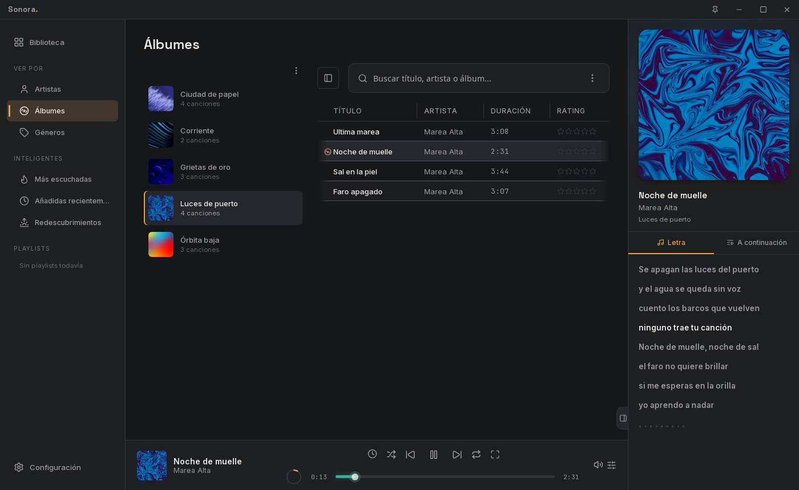

  

<h1 align="center">Sonora</h1>

  Un reproductor para la música que tienes en tu equipo.

  <a href="../../releases/latest"><b>Descargar la última versión</b></a>
  &nbsp;·&nbsp; Windows &nbsp;·&nbsp; Linux

  

## Qué es

Sonora es para quien tiene su música en archivos y quiere escucharla bien. Le indicas tu carpeta de música y arma la biblioteca sola: artistas, álbumes, géneros y portadas. Es liviano, no necesita cuenta y funciona sin internet.

## Lo que puedes hacer

- **Explorar tu biblioteca** por artista, álbum o género, con búsqueda instantánea y listas automáticas: lo más escuchado, lo añadido hace poco y canciones que hace tiempo no suenan.
- **Seguir la letra en tiempo real.** Lee archivos `.lrc` junto a tus canciones o las busca en internet, si lo permites. También trae un editor para sincronizar letras a mano.
- **Ajustar el sonido** con un ecualizador y perfiles para tu modelo de audífonos (basados en AutoEq), normalización de volumen y transición suave entre canciones.
- **Escuchar sin alteraciones.** En Windows tiene salida bit-perfect, que envía el audio a tu tarjeta de sonido sin pasar por el mezclador del sistema.
- **Personalizar el aspecto** con temas, o cargar skins clásicas de Winamp (`.wsz`).
- **Usar tus listas de siempre.** Abre y guarda listas `.m3u8` y `.pls`, e importa las de MusicBee.
- **Poner un visualizador** a pantalla completa, o pasar a un mini reproductor.
- **Ver tu resumen del año** con lo que más escuchaste.

## Instalación

| Sistema | Descarga |
|---|---|
| Windows | [`Sonora-Windows-Setup.exe`](../../releases/latest/download/Sonora-Windows-Setup.exe) |
| Linux, cualquier distribución | [`Sonora-Linux-x86_64.AppImage`](../../releases/latest/download/Sonora-Linux-x86_64.AppImage): dale permiso de ejecución (`chmod +x`) y ábrelo |
| Debian, Ubuntu | [`Sonora-Linux-amd64.deb`](../../releases/latest/download/Sonora-Linux-amd64.deb) |

En Windows puede aparecer un aviso de SmartScreen porque el instalador no está firmado con un certificado de pago. Elige *Más información → Ejecutar de todas formas*.

macOS no tiene versión por ahora. Las versiones anteriores están en [Releases](../../releases).

## Actualizaciones

Desde la app: *Configuración → Actualizaciones → Buscar actualizaciones*. Las actualizaciones van firmadas y la app rechaza cualquier archivo que no sea el original. En Linux, la actualización automática funciona con la versión AppImage.

---

Este repositorio solo publica los instaladores; el código fuente es privado. Si algo falla o tienes una idea, abre un [issue](../../issues).
